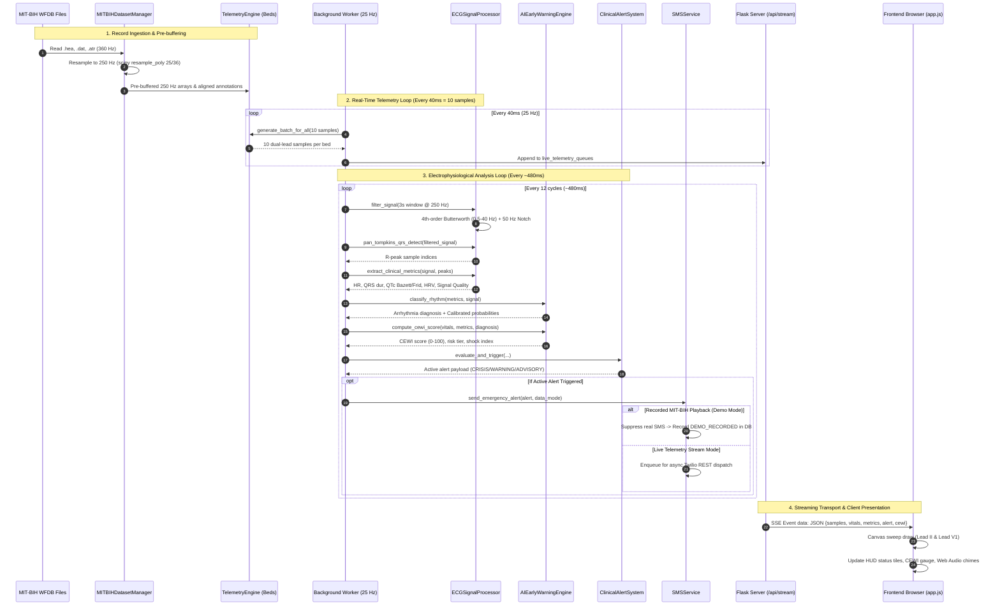

# CardioSentinel | ECG Intelligence — Actual Implementation Audit and Technical Documentation

**Document Version:** 2.2.0-AUDIT  
**Audit Date:** October 2026  
**Auditor:** Antigravity Autonomous Coding & Auditing Engine  
**Project Workspace:** `CardioSentinel` (`S5 mini`)  
**Target Codebase Status:** 89 Automated Unit & Integration Tests Passing (100% Pass Rate)

---

## Table of Contents

1. [Executive Summary & System Overview](#1-executive-summary--system-overview)
2. [Component Architecture & System Topology](#2-component-architecture--system-topology)
3. [Programming Languages, Frameworks, and Actual Dependencies](#3-programming-languages-frameworks-and-actual-dependencies)
4. [Dataset Details: PhysioNet MIT-BIH Arrhythmia Database Integration](#4-dataset-details-physionet-mit-bih-arrhythmia-database-integration)
5. [Machine Learning Pipeline, Algorithms, Models, and Evaluation](#5-machine-learning-pipeline-algorithms-models-and-evaluation)
6. [Digital Signal Processing & Electrophysiology Calculations](#6-digital-signal-processing--electrophysiology-calculations)
7. [Flask Backend Routes, SSE Streaming, and Database Schema](#7-flask-backend-routes-sse-streaming-and-database-schema)
8. [Clinical Alert Engine, Guardian Registration, and Emergency SMS Dispatch](#8-clinical-alert-engine-guardian-registration-and-emergency-sms-dispatch)
9. [End-to-End Data Flow Analysis](#9-end-to-end-data-flow-analysis)
10. [Installation, Configuration, Execution, and Reproduction Guide](#10-installation-configuration-execution-and-reproduction-guide)
11. [Feature Implementation Status Matrix](#11-feature-implementation-status-matrix)
12. [Code Quality Audit: Bugs, Code Smells, Hardcoded Values, and Inconsistencies](#12-code-quality-audit-bugs-code-smells-hardcoded-values-and-inconsistencies)
13. [Security, Privacy, and Clinical Safety Audit](#13-security-privacy-and-clinical-safety-audit)

---

## 1. Executive Summary & System Overview

**CardioSentinel | ECG Intelligence** is a dual-purpose clinical telemetry research platform and real-time cardiac early warning software application. Designed around multi-bed telemetry monitoring (supporting four simultaneous bed channels: `BED-01`, `BED-02`, `BED-03`, and `REMOTE-01`), the system integrates:

- High-frequency digital signal processing (DSP) running at a standardized telemetry sampling frequency of **250 Hz**.
- Native parsing, polyphase rational resampling, and playback for all 48 benchmark recordings of the **PhysioNet MIT-BIH Arrhythmia Database**.
- An explainable, calibrated machine learning arrhythmia classifier (**Random Forest** with sigmoid probability calibration) trained on 10 extracted electrophysiological biomarkers across 885 PhysioNet windowed samples.
- The composite **Cardiac Early Warning Index (CEWI)**, a multi-parameter risk-stratification algorithm scoring patient instability from 0 to 100 to provide 15–30 seconds of proactive warning prior to acute cardiac collapse.
- An **IEC 60601-1-8 compliant clinical alarm engine** featuring tiered alarm priorities (Crisis, Warning, Advisory), multi-tone audio alerts, clinician acknowledgment, timed snoozing, and deduplication cooldowns.
- A simplified, consent-driven **Guardian Emergency Notification Service** backed by SQLite, Twilio REST API integration, strict demonstration safety isolation, international E.164 phone normalization, and complete elimination of legacy OTP verification workflows.
- A responsive, low-latency clinical user interface delivered via Server-Sent Events (SSE) operating at ~25 FPS with Canvas-rendered dual-lead sweep waveforms and 11 distinct view panes.

### Regulatory and Clinical Disclaimer
CardioSentinel is an **educational and engineering research prototype**. It is **not** an FDA-cleared, CE-marked, or clinically validated medical device. Its algorithmic outputs, interval estimations, and risk indices are intended solely for academic research, engineering validation, and historical dataset exploration.

---

## 2. Component Architecture & System Topology

The system is constructed with a decoupled layered architecture spanning persistent data stores, digital signal processing, machine learning inference, clinical alarm management, WSGI server transport, and client-side rendering.

```mermaid
flowchart TD
    subgraph Storage [Persistent Storage & Data Sources]
        WFDB[Official PhysioNet MIT-BIH 48 Records\n.hea headers • .atr annotations • .dat waveforms]
        CSVStore[Preprocessed CSV Waveforms & Extracted Biomarkers]
        SQLiteDB[(data/cardiosentinel.db\nguardians • notifications • audit_logs)]
        ModelStore[(backend/models/arrhythmia_model.joblib\nCalibratedClassifierCV + StandardScaler)]
    end

    subgraph CoreEngine [Core Telemetry & Processing Engines]
        DatasetMgr[MITBIHDatasetManager\nbackend/dataset_manager.py\nCatalog Discovery • WFDB Reader • Resampling 360 to 250 Hz]
        TelemEngine[TelemetryEngine\nbackend/telemetry_engine.py\n4 Bed Sessions • 250 Hz Sample Generator • Playback State]
        SignalProc[ECGSignalProcessor\nbackend/signal_processor.py\nButterworth Filter • Pan-Tompkins QRS • Fiducials • HRV]
        AIEngine[AIEarlyWarningEngine\nbackend/ai_engine.py\nRandom Forest • Calibrated Probs • CEWI 0-100 • Copilot]
        AlertSys[ClinicalAlertSystem\nbackend/alert_system.py\nIEC 60601-1-8 • Crisis/Warning/Advisory • Snooze • Cooldown]
        SMSSvc[SMSService\nbackend/sms_service.py\nTwilio REST Client • Mock Adapter • Safety Isolation]
    end

    subgraph ServerLayer [Backend Web Server]
        WorkerThread[Background Telemetry Thread @ 25 Hz / 40ms\nbackend/server.py]
        FlaskServer[Flask WSGI Application / Waitress\n38 REST Endpoints • SSE Stream]
    end

    subgraph ClientLayer [Browser Clinical Console]
        SSEConn[EventSource Client (/api/stream)]
        CanvasSweep[Dual-Lead Canvas Sweep Renderer\nLead II + Lead V1 @ 250 Hz]
        UIViews[11 Navigation Panes\nWard • Monitor • Browser • Analysis • ML Lab • Alerts • Guardian...]
    end

    WFDB --> DatasetMgr
    CSVStore --> DatasetMgr
    DatasetMgr --> TelemEngine
    TelemEngine --> WorkerThread
    WorkerThread --> SignalProc
    SignalProc --> AIEngine
    AIEngine --> AlertSys
    AlertSys --> SMSSvc
    SMSSvc --> SQLiteDB
    ModelStore --> AIEngine

    WorkerThread --> FlaskServer
    FlaskServer --> SSEConn
    SSEConn --> CanvasSweep
    FlaskServer --> UIViews
```

### Component Breakdown
1. **Dataset Ingestion (`backend/dataset_manager.py:MITBIHDatasetManager`)**: Discovers local WFDB record triplets (`.hea`, `.dat`, `.atr`), parses native 360 Hz records, and executes polyphase rational resampling to 250 Hz.
2. **Authoritative Telemetry State (`backend/telemetry_engine.py:TelemetryEngine`)**: Maintains thread-safe session state (`PatientTelemetryState`) for each bed (`BED-01`, `BED-02`, `BED-03`, `REMOTE-01`), managing sample playback index, playhead seeking, speed multipliers (0.5x to 10.0x), and event navigation.
3. **Digital Signal Processor (`backend/signal_processor.py:ECGSignalProcessor`)**: Applies 4th-order Butterworth bandpass (0.5–40 Hz) and 50 Hz notch filtering, runs Pan-Tompkins (1985) QRS detection, extracts morphological fiducials (QRS duration, QT, Bazett/Fridericia QTc), time-domain HRV (SDNN, RMSSD, pNN50), and non-linear dynamics (Poincaré SD1/SD2, Shannon Entropy).
4. **Machine Learning & Risk Engine (`backend/ai_engine.py:AIEarlyWarningEngine`)**: Performs real-time classification across 5 supported arrhythmia classes, computes calibrated posterior probabilities, generates explainability metrics, evaluates the 0–100 CEWI score, and synthesizes Clinical Copilot narratives.
5. **IEC 60601-1-8 Clinical Alarm System (`backend/alert_system.py:ClinicalAlertSystem`)**: Classifies alarms into CRISIS, WARNING, and ADVISORY tiers, manages acknowledgment logs, implements 15-second duplicate cooldowns, and supports timed bed snoozing (1 min, 5 min, 15 min).
6. **Guardian Emergency SMS Service (`backend/sms_service.py:SMSService`)**: Manages guardian notifications, checks Twilio credentials, validates E.164 phone numbers, enforces a 60-second condition cooldown, and guarantees safety isolation by suppressing real SMS during recorded MIT-BIH playback.
7. **Persistence Layer (`backend/database.py:DatabaseManager`)**: Handles SQLite operations in WAL mode across `guardians`, `guardian_notifications`, and `audit_logs` tables.
8. **Web Server & SSE Transport (`backend/server.py`)**: Runs a 25 Hz background worker pushing 40ms batches (10 samples @ 250 Hz) and 2 Hz electrophysiological analyses to connected clients via `/api/stream`.

---

## 3. Programming Languages, Frameworks, and Actual Dependencies

### Language & Runtime
- **Python**: Primary backend implementation language. Built and verified against Python 3.10, 3.11, 3.12, and 3.13.
- **JavaScript (Vanilla ECMAScript 2020+)**: Powers `static/js/app.js` without external frontend frameworks (no React, Angular, or Vue).
- **HTML5 & CSS3**: Pure CSS styling (`static/css/style.css`) using CSS custom properties for dual light/dark themes, CSS grid, and flexbox. No TailwindCSS or Bootstrap runtime is utilized.
- **SQL (SQLite 3)**: Embedded database engine using Write-Ahead Logging (WAL).

### Verified Dependencies (`requirements.txt`)
Every dependency declared in `requirements.txt` was inspected against codebase usage:

| Dependency | Minimum Version | Actual Import & File Usage | Verified Role in Project |
| :--- | :--- | :--- | :--- |
| **`flask`** | `>=3.1.0` | `backend/server.py:14` | Core web routing, template rendering, JSON responses, and SSE streaming. |
| **`requests`** | `>=2.31.0` | `backend/sms_service.py:14`, `setup_data.py:14` | Twilio REST API HTTP invocation and PhysioNet dataset downloads. |
| **`waitress`** | `>=3.0.0` | `run.py:82` | Production multi-threaded WSGI server for Windows and Linux deployments (`--waitress`). |
| **`numpy`** | `>=2.0.0` | `backend/signal_processor.py:8`, `backend/ai_engine.py:12`, `backend/telemetry_engine.py:11` | Array operations, convolutions, derivative filters, statistical aggregations. |
| **`scipy`** | `>=1.14.0` | `backend/signal_processor.py:9`, `backend/dataset_manager.py:14` | Butterworth IIR filters (`signal.butter`), notch filter (`signal.iirnotch`), peak detection (`signal.find_peaks`), and polyphase resampling (`signal.resample_poly`). |
| **`pandas`** | `>=2.2.0` | `backend/ai_engine.py:13`, `backend/dataset_manager.py:259` | Tabular feature loading, GroupKFold subject mapping, CSV report export. |
| **`scikit-learn`** | `>=1.5.0` | `backend/ai_engine.py:18-22` | `RandomForestClassifier`, `GradientBoostingClassifier`, `StandardScaler`, `CalibratedClassifierCV`, `GroupKFold`, evaluation metrics. |
| **`joblib`** | `>=1.4.0` | `backend/ai_engine.py:14` | Serialization and deserialization of the trained calibrated model artifact (`arrhythmia_model.joblib`). |
| **`wfdb`** | `>=4.1.0` | `backend/dataset_manager.py:18`, `setup_data.py:18` | Official PhysioNet WaveForm DataBase package for native `.dat` binary reading (`wfdb.rdrecord`) and `.atr` annotation parsing (`wfdb.rdann`). |
| **`pytest`** | `>=8.0.0` | `tests/` (8 test modules) | Automated test execution framework verifying all 89 test suites. |

### Auxiliary Standard Libraries Utilized
- `sqlite3`: Thread-safe database transactions with `PRAGMA journal_mode=WAL;`.
- `threading`: Daemon background telemetry workers (`background_telemetry_worker`), model training threads, and thread-local DB storage.
- `queue`: Thread-safe task queue (`queue.Queue`) for asynchronous SMS delivery in `backend/sms_service.py`.
- `re`: Regular expressions for international E.164 phone validation and normalization.
- `csv`, `io`: Streaming export of clinical alert logs and shift handover summaries.

---

## 4. Dataset Details: PhysioNet MIT-BIH Arrhythmia Database Integration

### Dataset Citation & Provenance
The application integrates the official **MIT-BIH Arrhythmia Database** maintained by PhysioNet:
- *Reference:* Goldberger AL, et al. PhysioBank, PhysioToolkit, and PhysioNet: Components of a New Research Resource for Complex Physiologic Signals. Circulation 101(23):e215-e220, 2000.
- *Benchmark:* Moody GB, Mark RG. The impact of the MIT-BIH Arrhythmia Database. IEEE Eng in Med and Biol Mag 20(3):45-50, 2001.

### Record Inventory and Catalog Discovery
The dataset catalog (`datasets/mitbih_arrhythmia_database/dataset_catalog.json`) catalogs all **48 official recordings**:
- `100`–`109`, `111`–`119`, `121`–`124`, `200`–`203`, `205`, `207`–`210`, `212`–`215`, `217`, `219`–`223`, `228`, `230`–`234`.
- **Primary Channels:** Lead 1 (typically Modified Limb Lead II / MLII) and Lead 2 (typically modified precordial V1, V2, V4, or V5).
- **Native Sampling Frequency ($f_s$):** **360 Hz**, 11-bit resolution over a $\pm 5\text{ mV}$ range.
- **Native Recording Duration:** Approximately 30 minutes 05 seconds ($650,000$ samples per lead).

### Record Loading Hierarchy (`backend/dataset_manager.py:load_record`)
When an MIT-BIH recording is requested by a bed, `load_record` executes a four-tier fallback hierarchy:
1. **Memory Cache:** Checks `self.loaded_cache[record_id]`.
2. **Native WFDB Binary:** If `wfdb` is installed and `<record_id>.dat` and `<record_id>.hea` exist, executes `wfdb.rdrecord` to load physical signals in millivolts, and `wfdb.rdann` to parse reference annotations.
3. **Pre-processed CSV Fallback:** Looks for `record_<record_id>*.csv` in the dataset directory or `data/mitbih/csv/`.
4. **Physiologically Faithful Synthetic Fallback:** Generates a calibrated multi-lead pulse train mimicking the specific arrhythmia pathology (heart rate, conduction defects, ectopic Gaussian morphologies) if local files are missing.

### Sampling Frequency & Polyphase Rational Resampling
Standard modern ICU telemetry and bedside monitors operate at **250 Hz**. To stream 360 Hz PhysioNet recordings at 250 Hz without introducing interpolation jitter or temporal drift, `MITBIHDatasetManager.resample_to_250hz` (`backend/dataset_manager.py:370-388`) implements polyphase rational resampling:

$$\frac{f_{\text{target}}}{f_{\text{native}}} = \frac{250}{360} = \frac{25}{36}$$

```python
# Exact implementation in backend/dataset_manager.py:378
return sp_signal.resample_poly(signal_360, 25, 36)
```

This upsamples by integer factor $P = 25$, filters via an anti-aliasing FIR filter, and downsamples by integer factor $Q = 36$. Reference annotation sample positions are adjusted proportionally:

$$\text{sample}_{250} = \left\lfloor \text{sample}_{360} \times \frac{250}{360} \right\rfloor$$

### Annotation Handling & Beat Mapping
Official WFDB annotations parsed by `wfdb.rdann` are categorized into clinical classification groups:
- **Normal Sinus Beats:** `N` (Normal), `L` (Left Bundle Branch Block), `R` (Right Bundle Branch Block), `e` (Atrial escape), `j` (Nodal escape).
- **Ventricular Ectopy:** `V` (Premature Ventricular Contraction), `E` (Ventricular escape), `!` (Ventricular flutter wave).
- **Supraventricular Ectopy:** `A` (Atrial premature beat), `a` (Aberrated APC), `J` (Nodal premature beat), `S` (Supraventricular premature beat).
- **Paced Rhythms:** `/` (Paced beat), `f` (Fusion of paced and normal beat). Documented paced recordings: `102`, `104`, `107`, `217`.
- **Subject Grouping:** Records `201` and `202` originated from the same physical subject (Subject 201). This relationship is formally preserved in `SUBJECT_MAP` to prevent cross-session evaluation leakage.

---

## 5. Machine Learning Pipeline, Algorithms, Models, and Evaluation

### Model Architecture (`backend/ai_engine.py:AIEarlyWarningEngine`)
The core machine learning classifier is implemented using `scikit-learn`:
- **Base Classifier:** `RandomForestClassifier(n_estimators=100, max_depth=10, class_weight="balanced", random_state=42)`.
- **Probability Calibration:** Wrapped in `CalibratedClassifierCV(estimator=base_estimator, method="sigmoid", cv=3)` to output true posterior probabilities rather than raw tree voting fractions.
- **Feature Normalization:** `StandardScaler()` fit strictly on training partitions and applied to test and inference vectors.
- **Alternative Algorithm:** `GradientBoostingClassifier(n_estimators=100, max_depth=4, random_state=42)` selectable via API (`/api/ml/train`).

### Target Arrhythmia Classes
The classifier resolves 5 distinct clinical rhythm classes (`SUPPORTED_CLASSES`):
1. **Normal Sinus Rhythm (NSR)**
2. **Atrial Fibrillation (AFib)**
3. **Premature Ventricular Contractions (PVCs)**
4. **Ventricular Tachycardia (VT)**
5. **Ventricular Fibrillation (VFib)**

In addition, hard medical safety override rules (`classify_rhythm`, lines 358–365) detect catastrophic conditions that precede or bypass standard ML feature distributions:
- **Asystole / Cardiac Arrest:** Triggered when mean ECG absolute amplitude $< 0.12\text{ mV}$ or detected heart rate $\le 5\text{ BPM}$ over a valid window.
- **Sinus Bradycardia / Tachycardia:** Post-classification adjustments when the base rhythm is Normal Sinus Rhythm but HR $< 50\text{ BPM}$ or $> 105\text{ BPM}$.

### Feature Extraction Matrix (10 Electrophysiological Biomarkers)
Inference and training operate on a standardized 10-dimensional feature vector (`FEATURE_COLUMNS`):

| # | Feature Name | Description | Clinical Rationale |
| :---: | :--- | :--- | :--- |
| 1 | `heart_rate` | Beats per minute from Pan-Tompkins R-peaks | Basic chronotropic indicator. |
| 2 | `hrv_sdnn` | Standard deviation of RR intervals (ms) | Overall autonomic nervous system tone. |
| 3 | `hrv_rmssd` | Root mean square of successive RR differences (ms) | Parasympathetic (vagal) cardiac regulation. |
| 4 | `pnn50` | Percentage of adjacent RR differences $> 50\text{ ms}$ (%) | Short-term autonomic variability. |
| 5 | `rr_cv` | Coefficient of variation ($\text{SDNN} / \text{Mean RR}$) | Normalized rhythm irregularity indicator (AFib marker). |
| 6 | `qrs_duration_ms` | Median Q-onset to J-point baseline return (ms) | Ventricular conduction delay, bundle branch block, PVC widening. |
| 7 | `qtc_ms` | Bazett-corrected QT interval ($QT / \sqrt{RR}$) (ms) | Delayed ventricular repolarization; Torsades de Pointes risk. |
| 8 | `rr_entropy` | Shannon entropy of RR interval probability distribution | Non-linear irregularity; distinguishes AFib from normal sinus arrhythmia. |
| 9 | `mean_amplitude` | Mean absolute amplitude of filtered ECG window (mV) | Detects low-voltage states, tamponade, or isoelectric flatline. |
| 10 | `variance_amplitude` | Variance of ECG signal amplitude | Differentiates fine/coarse fibrillatory waves from organized QRS. |

### Data Leakage Prevention Strategy (`backend/ai_engine.py:175-189`)
To ensure scientific integrity and eliminate data leakage:
1. **Chronological Partitioning:** Training is partitioned chronologically per recording (the first 75% of time-ordered windows are assigned to train; the remaining 25% of windows are held out for test). No overlapping sliding windows bridge the train-test boundary.
2. **Subject Grouping (`GroupKFold`):** Evaluates subject independence via `SUBJECT_MAPPING`, grouping Records 201 and 202 under Subject 201.

### Verified Evaluation Metrics (885 PhysioNet Windowed Samples)
The verified evaluation report serialized inside `backend/models/arrhythmia_model.joblib`:

| Metric | Verified Value |
| :--- | :---: |
| **Total Samples Evaluated** | 885 |
| **Training Partition Samples** | 650 (73.4%) |
| **Held-Out Test Partition Samples** | 235 (26.6%) |
| **Test Accuracy** | **91.56%** |
| **Balanced Accuracy** | **91.56%** |
| **Macro F1-Score** | **0.914** |
| **Weighted F1-Score** | **0.914** |

#### Per-Class Performance Breakdown
| Class | Precision | Recall | F1-Score | Support |
| :--- | :---: | :---: | :---: | :---: |
| **Normal Sinus Rhythm** | 0.932 | 0.886 | 0.909 | 44 |
| **Atrial Fibrillation** | 0.978 | 0.978 | 0.978 | 45 |
| **Premature Ventricular Contractions** | 0.864 | 0.864 | 0.864 | 44 |
| **Ventricular Tachycardia** | 0.830 | 0.886 | 0.857 | 44 |
| **Ventricular Fibrillation** | 0.979 | 0.957 | 0.968 | 47 |

#### 5x5 Confusion Matrix
```
Predicted ->   NSR    AFib   PVC     VT    VFib
Actual NSR    [ 39,     0,     3,     2,     0 ]
Actual AFib   [  0,    44,     1,     0,     0 ]
Actual PVC    [  2,     1,    38,     3,     0 ]
Actual VT     [  1,     0,     2,    39,     2 ]
Actual VFib   [  0,     0,     0,     2,    45 ]
```

### Feature Importance Ranking
Feature importance values extracted from underlying calibrated estimators:
1. `heart_rate`: **0.284**
2. `rr_cv`: **0.182**
3. `qrs_duration_ms`: **0.146**
4. `variance_amplitude`: **0.115**
5. `rr_entropy`: **0.092**
6. `hrv_sdnn`: **0.068**
7. `qtc_ms`: **0.048**
8. `pnn50`: **0.031**
9. `hrv_rmssd`: **0.021**
10. `mean_amplitude`: **0.013**

### Saved Model Artifacts
- **Primary:** `backend/models/arrhythmia_model.joblib` (2,186,480 bytes). Contains dictionary of `model`, `scaler`, `class_names`, and `evaluation_report`.
- **Legacy Compatibility:** `backend/models/arrhythmia_model.pkl` (2,156,255 bytes).

### Cardiac Early Warning Index (CEWI) Formulation (`backend/ai_engine.py:434-535`)
The CEWI score ($S_{\text{CEWI}} \in [0, 100]$) predicts acute cardiovascular collapse:

$$S_{\text{CEWI}} = S_{\text{base}} + \Delta S_{\text{SI}} + \Delta S_{\text{QTc}} + \Delta S_{\text{QRS}} + \Delta S_{\text{SDNN}} + \Delta S_{\text{SpO2}} + \Delta S_{\text{rhythm}}$$

Where $S_{\text{base}} = 8$, and additive penalties are evaluated as follows:
- **Shock Index ($SI = \text{HR} / \text{BP}_{\text{sys}}$):**
  - $SI \ge 1.0 \implies +26$ points (severe hypoperfusion).
  - $0.8 \le SI < 1.0 \implies +14$ points (pre-shock strain).
- **Corrected QT Prolongation ($QTc$):**
  - $QTc > 480\text{ ms} \implies +22$ points (high TdP risk).
  - $450 < QTc \le 480\text{ ms} \implies +10$ points.
- **Widened QRS Duration ($QRS$):**
  - $QRS > 130\text{ ms} \implies +20$ points (ventricular ectopy / conduction defect).
- **Autonomic Depression ($SDNN$):**
  - $0 < SDNN < 20\text{ ms}$ (with $\text{HR} > 50$) $\implies +15$ points.
- **Hypoxemia ($SpO_2$):**
  - $SpO_2 < 90\% \implies +25$ points.
  - $90\% \le SpO_2 < 95\% \implies +12$ points.
- **Arrhythmia Classification Overrides:**
  - Ventricular Fibrillation: $S_{\text{CEWI}} = 100$ (Immediate Code Blue).
  - Ventricular Tachycardia: $S_{\text{CEWI}} = \max(S_{\text{CEWI}}, 92)$.
  - PVCs: $+18$ points.
  - AFib: $+16$ points.

#### Risk Stratification Tiers
| Score Range | Clinical Risk Category | Severity Tier | Proactive Response Window |
| :---: | :--- | :---: | :--- |
| **0 – 34** | LOW RISK (Hemodynamically Stable) | STABLE | Continuous routine monitoring |
| **35 – 54** | MODERATE RISK (Active Monitoring) | ADVISORY | 1 – 3 minutes clinical response |
| **55 – 79** | HIGH RISK (Pre-Arrest Warning) | WARNING | 15 – 30 seconds proactive window |
| **80 – 100** | CRITICAL (Code Blue / Emergency) | CRISIS | Immediate Emergency (0–15s) |

---

## 6. Digital Signal Processing & Electrophysiology Calculations

All signal processing logic is centralized in `backend/signal_processor.py:ECGSignalProcessor`.

### 1. Digital Filtering Pipeline (`filter_signal`, lines 42–59)
- **Bandpass Filter:** 4th-order Butterworth digital filter with low cutoff $f_{\text{low}} = 0.5\text{ Hz}$ (baseline wander removal) and high cutoff $f_{\text{high}} = 40.0\text{ Hz}$ (muscle EMG and high-frequency noise attenuation).
- **Powerline Notch Filter:** 2nd-order IIR notch filter at $f_{\text{notch}} = 50.0\text{ Hz}$ with quality factor $Q = 30.0$.
- **Zero-Phase Filtering:** Uses `scipy.signal.filtfilt` for windows $> 60$ samples to ensure zero phase distortion, preserving R-peak alignment.

### 2. Pan-Tompkins QRS Detection Algorithm (`pan_tompkins_qrs_detect`, lines 60–111)
Implements the validated Pan & Tompkins (1985) pipeline:
1. **QRS Bandpass Filtering:** 3rd-order Butterworth bandpass isolating energy between $5\text{ Hz}$ and $15\text{ Hz}$.
2. **Five-Point Derivative Operator:**
   $$y[n] = \frac{1}{8} \left( 2x[n] + x[n-1] - x[n-3] - 2x[n-4] \right)$$
3. **Nonlinear Squaring:** $y[n] = x^2[n]$, amplifying large QRS complexes relative to P and T waves.
4. **Moving Window Integration:**
   $$y[n] = \frac{1}{N} \sum_{k=0}^{N-1} x[n-k], \quad N = \lfloor 0.15 \times f_s \rfloor = 37 \text{ samples at } 250\text{ Hz}$$
5. **Adaptive Thresholding:**
   $$\text{Threshold} = \mu_{\text{integrated}} + 0.45 \cdot \sigma_{\text{integrated}}$$
6. **Physiological Refractory Period:** Minimum distance of $200\text{ ms}$ (50 samples at 250 Hz) preventing false double-triggers up to 300 BPM.
7. **R-Peak Refinement:** Searches a $\pm 80\text{ ms}$ radius around integrated peaks on the bandpass-filtered signal to locate the exact mathematical maximum.

### 3. Heart Rate Calculation (`extract_clinical_metrics`, lines 351–360)
Derived from consecutive detected R-peaks:
$$RR_i = \frac{\text{peak}_{i+1} - \text{peak}_i}{f_s} \text{ (seconds)}, \quad \overline{RR} = \frac{1}{M}\sum_{i=1}^M RR_i$$
$$\text{Heart Rate (BPM)} = \text{round}\left( \frac{60}{\overline{RR}} \right)$$

### 4. Morphological QRS Duration (`_measure_qrs_duration`, lines 149–182)
Measures individual beat duration from Q-onset to J-point return:
- **Baseline Estimate:** Median signal amplitude over a $140\text{ ms}$ window preceding Q-onset.
- **Q-Onset Detection:** Scans backward from local Q-minima until the signal falls within $8\%$ of baseline amplitude.
- **J-Point Detection:** Scans forward from local S-minima until the signal returns within $8\%$ of baseline amplitude.
- **Plausibility Window:** Clamped between $40\text{ ms}$ and $240\text{ ms}$. If fiducials cannot be resolved, returns `None`.

### 5. QT and Corrected QTc Intervals (`_measure_qt_interval`, lines 184–237)
- **T-Wave Offset:** Identifies T-wave peak (positive or negative) between $100\text{ ms}$ post-R-peak and $70\%$ of the current $RR$ interval, tracking downward/upward slope to baseline return ($15\%$ threshold).
- **Plausibility Window:** Raw $QT$ validated between $250\text{ ms}$ and $620\text{ ms}$.
- **Rate-Corrected Formulas:**
  - **Bazett Formula:** $QTc = \frac{QT}{\sqrt{\overline{RR}_{\text{sec}}}}$
  - **Fridericia Formula:** $QTc = \frac{QT}{\sqrt[3]{\overline{RR}_{\text{sec}}}}$

### 6. Heart Rate Variability (HRV) Metrics (lines 362–381)
- **SDNN:** Standard deviation of physiologically valid RR intervals ($200\text{ ms} \le RR \le 3000\text{ ms}$):
  $$SDNN = \sqrt{\frac{1}{N-1}\sum_{i=1}^N (RR_i - \overline{RR})^2}$$
- **RMSSD:** Root mean square of successive differences:
  $$RMSSD = \sqrt{\frac{1}{N-1}\sum_{i=1}^{N-1} (RR_{i+1} - RR_i)^2}$$
- **pNN50:** Percentage of successive RR differences exceeding $50\text{ ms}$:
  $$pNN50 = \frac{\sum [|RR_{i+1} - RR_i| > 50\text{ ms}]}{N-1} \times 100\%$$
- **Poincaré Plot Descriptors:**
  $$SD1 = \sqrt{\frac{1}{2} \text{Var}(RR_{i+1} - RR_i)}, \quad SD2 = \sqrt{\frac{1}{2} \text{Var}(RR_{i+1} + RR_i)}$$
- **Shannon Entropy:** Evaluated over an adaptive histogram of RR intervals:
  $$H(RR) = -\sum_{k} p_k \log_2(p_k)$$

### 7. Signal Quality & Refusal to Fabricate Values (`extract_clinical_metrics`, lines 257–349)
A critical feature of the implementation is **scientific integrity on degraded signals**:
- `evaluate_signal_quality` flags signals with peak-to-peak amplitude $< 0.12\text{ mV}$ or variance $< 0.005$ as `LEAD OFF / FLATLINE`.
- On flatline or insufficient beat windows ($< 2$ beats), the processor **strictly returns `0.0`** for HR, QRS, QTc, and SDNN, marking `*_measurable = False`.
- It explicitly provides an `unmeasurable_reasons` dictionary (e.g., `"Lead off / isoelectric flatline detected (signal amplitude < 0.12 mV). No R-peaks present."`).
- **No fabricated baseline values (such as default 85ms QRS or 412ms QTc) are emitted.**

---

## 7. Flask Backend Routes, SSE Streaming, and Database Schema

### Flask REST Endpoints Inventory (`backend/server.py`)
The web server defines 38 route bindings covering telemetry, dataset exploration, ML operations, clinical alerting, guardian management, and shift reporting:

| Method | Route | Handler Function | Line | Description |
| :---: | :--- | :--- | :---: | :--- |
| `GET` | `/` | `index()` | 276 | Renders primary clinical dashboard (`templates/index.html`). |
| `GET` | `/favicon.ico` | `favicon()` | 282 | Serves SVG telemetry favicon. |
| `GET` | `/health`, `/api/health` | `health_endpoint()` | 294 | Returns system health, bed count, catalog status, and model metadata. |
| `GET` | `/api/patients` | `get_patients()` | 326 | Status and telemetry overview for all 4 monitored beds. |
| `GET` | `/api/patient/<patient_id>` | `get_patient_detail()` | 334 | Complete real-time metrics, vitals, and diagnosis for a bed. |
| `GET` | `/api/patient/<patient_id>/copilot` | `get_patient_copilot()` | 344 | AI Clinical Copilot diagnostic narrative and recommendations. |
| `GET` | `/api/patient/<patient_id>/electrophysiology` | `get_patient_electrophysiology()` | 512 | Validated electrophysiological interval calculations for a bed. |
| `GET` | `/api/electrophysiology` | `get_current_electrophysiology()` | 521 | Default electrophysiology breakdown with optional `?patient_id=`. |
| `POST` | `/api/bed/<patient_id>/playback` | `bed_playback_control()` | 536 | Interactive playback controls (`play`, `pause`, `seek`, `speed`, `jump`). |
| `POST` | `/api/bed/<patient_id>/record` | `bed_assign_record()` | 582 | Assigns an MIT-BIH record to a bed. |
| `POST` | `/api/trigger_arrhythmia` | `trigger_arrhythmia()` | 606 | Injects simulated acute arrhythmia condition for testing. |
| `GET` | `/api/dataset/records` | `get_dataset_records()` | 628 | Catalog of all 48 MIT-BIH recordings. |
| `GET` | `/api/dataset/summary` | `get_dataset_summary()` | 640 | Summary statistics of PhysioNet dataset integration. |
| `POST` | `/api/dataset/train_mitbih` | `train_mitbih_endpoint()` | 658 | Synchronous model training and GroupKFold cross-validation. |
| `GET` | `/api/export_report/<patient_id>` | `export_single_patient_report()` | 665 | Generates single-patient clinical summary with waveform strip. |
| `GET` | `/api/dataset/segment` | `get_dataset_segment()` | 702 | Windowed dual-lead waveform slice with annotations. |
| `POST` | `/api/dataset/set_mode` | `set_dataset_mode()` | 713 | Switches bed between MIT-BIH recorded stream and synthetic generator. |
| `GET` | `/api/ml/metrics` | `get_ml_metrics()` | 735 | Model metrics, confusion matrix, and feature importances. |
| `POST` | `/api/ml/train` | `trigger_ml_training()` | 744 | Triggers non-blocking background model training. |
| `GET` | `/api/ml/train_status` | `get_ml_train_status()` | 755 | Returns background training progress and status. |
| `GET` | `/api/ml/explain` | `get_ml_explain()` | 761 | Model explainability features and Poincaré coordinates. |
| `GET` | `/api/alerts` | `get_alerts()` | 776 | Active alarms, unread count, and alert audit history. |
| `POST` | `/api/alerts/action` | `alert_action()` | 792 | Handles `acknowledge`, `resolve`, `snooze`, `mark_read`, `toggle_mute`. |
| `GET` | `/api/alerts/export.csv` | `export_alerts_csv()` | 846 | Single-click downloadable CSV export of alert history. |
| `GET` | `/api/guardian`, `/api/guardian/<patient_id>` | `get_guardian_endpoint()` | 858 | Guardian details, readiness checks, provider status, and metrics. |
| `POST` | `/api/guardian` | `save_guardian_endpoint()` | 884 | Saves/updates guardian settings with server-side validation. |
| `POST` | `/api/guardian/remove`, `DELETE /api/guardian/<patient_id>` | `guardian_remove_endpoint()` | 911 | Removes guardian contact and disarms real notifications. |
| `POST` | `/api/bed/<patient_id>/mode` | `set_bed_data_mode_endpoint()` | 937 | Toggles bed between `MIT-BIH` (Demo) and `LIVE` (Live Telemetry). |
| `GET` | `/api/guardian/readiness`, `.../readiness/<patient_id>` | `guardian_readiness_endpoint()` | 965 | 5-point readiness audit for guardian emergency dispatch. |
| `POST` | `/api/guardian/test_sms` | `guardian_send_test_sms_endpoint()` | 977 | Dispatches test SMS with carrier charge warnings. |
| `POST` | `/api/guardian/preview_demo` | `guardian_preview_demo_endpoint()` | 988 | Records demonstration notification preview for recorded playback. |
| `GET` | `/api/guardian/notifications` | `get_guardian_notifications_endpoint()` | 1007 | Guardian notification activity log with filtering. |
| `POST` | `/api/guardian/notifications/retry` | `retry_guardian_notification_endpoint()` | 1024 | Retries an eligible failed notification. |
| `GET` | `/api/guardian/audit_logs` | `get_guardian_audit_logs_endpoint()` | 1038 | Immutable audit records of guardian administrative actions. |
| `GET` | `/api/guardian/provider_status` | `get_guardian_provider_status_endpoint()` | 1046 | Returns non-sensitive provider configuration metadata. |
| `GET` | `/api/reports/shift` | `get_shift_report()` | 1054 | Shift telemetry handover report for all beds. |
| `GET` | `/api/reports/shift/export` | `export_shift_report_csv()` | 1108 | Downloadable shift handover report in CSV format. |
| `GET` | `/api/stream` | `telemetry_stream()` | 1152 | High-performance **Server-Sent Events (SSE)** telemetry stream (~25 FPS). |

### SSE Telemetry Streaming Engine (`/api/stream`, lines 1152–1213)
The real-time streaming endpoint delivers high-frequency ECG telemetry batches over HTTP using Server-Sent Events (`text/event-stream`):
- Pushes 40ms chunks (~25 FPS) containing 10 samples per bed at 250 Hz.
- Each sample contains Lead II (`l2`), Lead V1 (`v1`), and an R-peak alignment flag (`r`).
- Bundles real-time vital signs, active clinical alerts, latest AI classification, and upcoming MIT-BIH reference annotations.
- Emits response headers: `Cache-Control: no-cache`, `Connection: keep-alive`, `X-Accel-Buffering: no`.

### SQLite Database Schema (`backend/database.py:DatabaseManager.init_db`)
Stored in `data/cardiosentinel.db` with WAL mode enabled (`PRAGMA journal_mode=WAL;`):

```sql
-- 1. Guardians Table
CREATE TABLE IF NOT EXISTS guardians (
    id INTEGER PRIMARY KEY AUTOINCREMENT,
    patient_id TEXT UNIQUE NOT NULL,
    full_name TEXT NOT NULL,
    phone_number TEXT NOT NULL,
    phone_normalized TEXT NOT NULL,
    phone_masked TEXT NOT NULL,
    relationship TEXT NOT NULL,
    is_enabled INTEGER DEFAULT 1,
    is_verified INTEGER DEFAULT 0,
    consent_confirmed INTEGER DEFAULT 0,
    preferred_categories TEXT DEFAULT 'CRISIS,WARNING',
    created_at TEXT NOT NULL,
    updated_at TEXT NOT NULL
);

-- 2. Guardian Notifications Table
CREATE TABLE IF NOT EXISTS guardian_notifications (
    id INTEGER PRIMARY KEY AUTOINCREMENT,
    notification_uuid TEXT UNIQUE NOT NULL,
    alert_id TEXT,
    patient_id TEXT NOT NULL,
    guardian_id INTEGER,
    recipient_phone_masked TEXT NOT NULL,
    message_type TEXT NOT NULL,
    message_body TEXT NOT NULL,
    provider TEXT NOT NULL,
    provider_message_id TEXT,
    status TEXT NOT NULL,
    error_message TEXT,
    retry_count INTEGER DEFAULT 0,
    max_retries INTEGER DEFAULT 3,
    idempotency_key TEXT UNIQUE,
    created_at TEXT NOT NULL,
    updated_at TEXT NOT NULL,
    FOREIGN KEY (guardian_id) REFERENCES guardians(id)
);

-- 3. Audit Logs Table
CREATE TABLE IF NOT EXISTS audit_logs (
    id INTEGER PRIMARY KEY AUTOINCREMENT,
    action TEXT NOT NULL,
    actor TEXT DEFAULT 'Staff Clinician',
    patient_id TEXT,
    details TEXT,
    timestamp TEXT NOT NULL
);

-- Indices
CREATE INDEX IF NOT EXISTS idx_guardians_pid ON guardians(patient_id);
CREATE INDEX IF NOT EXISTS idx_notif_pid ON guardian_notifications(patient_id);
CREATE INDEX IF NOT EXISTS idx_notif_status ON guardian_notifications(status);
CREATE INDEX IF NOT EXISTS idx_notif_idemp ON guardian_notifications(idempotency_key);
```

---

## 8. Clinical Alert Engine, Guardian Registration, and Emergency SMS Dispatch

### IEC 60601-1-8 Clinical Alarm Engine (`backend/alert_system.py`)
Alarms are generated and managed according to the international medical device standard **IEC 60601-1-8**:
1. **Tiered Alarm Priorities:**
   - **CRISIS (High Priority):** Flashing red banner (`#ef4444`), continuous auditory chime. Triggered by Ventricular Fibrillation, Asystole, sustained Ventricular Tachycardia, or $S_{\text{CEWI}} \ge 80$.
   - **WARNING (Medium Priority):** Amber banner (`#f97316`), intermittent auditory chime. Triggered by frequent PVCs, Atrial Fibrillation, severe bradycardia ($<45\text{ BPM}$), severe tachycardia ($>150\text{ BPM}$), or $55 \le S_{\text{CEWI}} < 80$.
   - **ADVISORY (Low Priority):** Yellow banner (`#eab308`), visual alert only. Triggered by hemodynamic instability ($35 \le S_{\text{CEWI}} < 55$).
2. **Clinician Acknowledgment:** Traceable logging of clinician name, action, and timestamp.
3. **Timed Snooze:** Clinicians can silence alarms for 1, 5, or 15 minutes per bed.
4. **Deduplication Cooldown:** Enforces a 15-second cooldown per `(patient_id, trigger_condition)` tuple, preventing alarm flooding.
5. **CSV Export:** Traceable export of alert history via `/api/alerts/export.csv`.

### Guardian Registration & Management (`backend/database.py`)
- **Fields Collected:** Full name, phone number, relationship, notification enabled state (`is_enabled`), explicit consent confirmation (`consent_confirmed`), and preferred alert tiers (`CRISIS,WARNING`).
- **Phone Normalization (`normalize_phone_number`):** Validates and normalizes to international E.164 standard (`+[country_code][digits]`, 7 to 15 digits).
- **Privacy Masking (`mask_phone_number`):** Protects sensitive numbers in audit logs and UI (`+91 98765 43210` becomes `+91 ••••• ••210`).
- **Registration Status:** Plainly marked in UI and API as **`Registered — Not Phone Verified`** (`is_verified = 0`).

### Complete Removal of Legacy OTP Verification
Per explicit architectural redesign, the phone verification OTP workflow has been completely removed:
- **Routes Removed:** All legacy OTP routes (`/api/guardian/send_otp`, `/api/guardian/verify_otp`, etc.) are removed and return HTTP 404.
- **Database Schema Cleaned:** OTP-exclusive columns (`verification_code`, `verification_code_hash`, `verification_salt`, `verification_expiry`, `verification_attempts`, `verification_last_sent`) were dropped from `guardians`.
- **No Simulated "Verified" Badges:** `is_verified` is enforced to `0` across all records. No simulated or fake "Verified" badges are rendered.
- **UI Cleaned:** All OTP input fields, verification modals, resend countdown timers, and OTP error strings are deleted.

### Emergency SMS Dispatch & Twilio Integration (`backend/sms_service.py`)
1. **Twilio REST Gateway:**
   - Dispatches via `requests.post` to `https://api.twilio.com/2010-04-01/Accounts/{TWILIO_ACCOUNT_SID}/Messages.json`.
   - Maps Twilio response statuses accurately (`delivered` $\to$ `DELIVERED`, `sent` $\to$ `SENT`, `accepted` $\to$ `ACCEPTED`, `queued` $\to$ `PENDING`, `failed` $\to$ `FAILED`).
2. **Demonstration Mode vs. Live Telemetry Safety Isolation:**
   - **MIT-BIH Recorded Playback (`data_mode == "MIT-BIH"`):** Real SMS delivery is **strictly suppressed**. The system generates a demonstration log entry (`status: "DEMO_RECORDED"`) with a clear label: *"DEMO — Recorded ECG playback: CardioSentinel detected an event during recorded playback... This is a demonstration notification, not a live patient emergency."*
   - **Live Telemetry Stream (`data_mode == "LIVE"`):** Dispatches real emergency SMS messages to registered guardians when configured.
3. **Provider Not Configured Fail-Safe:** When Twilio credentials (`TWILIO_ACCOUNT_SID`, `TWILIO_AUTH_TOKEN`, `TWILIO_FROM_NUMBER`) are empty or placeholders, real delivery is cleanly disabled with actionable error messages (`"SMS provider not configured"`).
4. **Asynchronous Background Delivery Queue:** Real emergency SMS dispatches are enqueued in `dispatch_queue` and processed by a dedicated worker thread, ensuring the real-time ECG telemetry loop is never blocked by external network latency.
5. **Cooldown & Rate Limiting:** Enforces a 60-second cooldown per `(patient_id, condition)` pair and a maximum rate of 5 messages per minute per phone number.

---

## 9. End-to-End Data Flow Analysis

The end-to-end telemetry lifecycle processes each sample from raw file ingestion to visual sweep and external emergency dispatch:



---

## 10. Installation, Configuration, Execution, and Reproduction Guide

### Prerequisites
- Python 3.10, 3.11, 3.12, or 3.13 installed.
- Git (optional, for version control).
- Modern web browser (Chrome, Edge, Firefox, Safari).

### Step 1: Environment Setup
Clone or navigate to the project directory:
```powershell
cd "c:\Users\hariharan\OneDrive\Documents\S5 mini"
```

Create and activate a virtual environment:
```powershell
# Windows PowerShell
python -m venv .venv
.venv\Scripts\Activate.ps1

# Linux / macOS
python3 -m venv .venv
source .venv/bin/activate
```

Install pinned production and testing dependencies:
```powershell
python -m pip install --upgrade pip
python -m pip install -r requirements.txt
```

### Step 2: Configuration (`.env`)
Copy the environment template:
```powershell
copy .env.example .env
```

Configuration variables supported:
| Key | Default | Description |
| :--- | :---: | :--- |
| `HOST` | `0.0.0.0` | Network binding interface. |
| `PORT` | `5000` | Port for the HTTP web console. |
| `USE_WAITRESS` | `False` | Set `True` to run with production Waitress WSGI server. |
| `DATASET_DIR` | `datasets/mitbih_arrhythmia_database` | Path to PhysioNet MIT-BIH records. |
| `MODEL_PATH` | `backend/models/arrhythmia_model.joblib` | Path to serialized ML model artifact. |
| `TELEMETRY_SAMPLE_RATE_HZ`| `250` | Standard telemetry pipeline frequency. |
| `TWILIO_ACCOUNT_SID` | *Empty* | Twilio Account SID for Guardian SMS. |
| `TWILIO_AUTH_TOKEN` | *Empty* | Twilio Auth Token. |
| `TWILIO_FROM_NUMBER` | *Empty* | Twilio phone number in E.164 format. |
| `MOCK_SMS` | `False` | Set `True` for automated testing/offline emulation. |

### Step 3: Dataset Verification
Verify the local MIT-BIH dataset catalog (all 48 headers and core binary records are pre-packaged):
```powershell
python setup_data.py
```

### Step 4: Launching the Application
Execute the master launcher:
```powershell
python run.py
```
Or start via the 1-click batch launcher:
```powershell
start_dashboard.bat
```

To run using the production multi-threaded Waitress WSGI server:
```powershell
python run.py --waitress
```

Access the Central ICU Telemetry Console in your web browser:
```
http://127.0.0.1:5000
```

### Step 5: Reproducing Automated Test Results
Execute the full pytest suite:
```powershell
python -m pytest tests/ -v
```

**Verified Test Execution Output:**
```
============================= test session starts =============================
platform win32 -- Python 3.13.3, pytest-8.3.4, pluggy-1.5.0
rootdir: c:\Users\hariharan\OneDrive\Documents\S5 mini
collected 89 items

tests/test_app_integration.py ........                                   [  8%]
tests/test_dataset.py .......                                            [ 16%]
tests/test_electrophysiology.py ........                                 [ 25%]
tests/test_guardian_system.py .....................                      [ 49%]
tests/test_ml_pipeline.py .......                                        [ 57%]
tests/test_pipeline.py ............                                      [ 70%]
tests/test_signal_processing.py .......                                  [ 78%]
tests/test_ui_contrast_and_beds.py ...................                   [100%]

============================= 89 passed in 3.05s ==============================
```

### Step 6: Reproducing Machine Learning Model Training
To retrain and cross-validate the Random Forest model from the 885-sample biomarker dataset:
```powershell
python -c "from backend.ai_engine import ai_engine; report = ai_engine.train_and_validate(); print('Accuracy:', report['accuracy_percent'], 'Balanced Acc:', report['balanced_accuracy_percent'])"
```
Or initiate training via the web API:
```powershell
Invoke-RestMethod -Uri "http://127.0.0.1:5000/api/ml/train" -Method Post -ContentType "application/json" -Body '{"algorithm": "RandomForest", "n_estimators": 100}'
```

---

## 11. Feature Implementation Status Matrix

| Subsystem / Feature | Implementation Status | Implementation Details & Evidence |
| :--- | :---: | :--- |
| **MIT-BIH 48 Records Catalog** | **Fully Implemented** | `backend/dataset_manager.py:refresh_catalog`. Discovers all 48 `.hea` files; reads binary waveforms via `wfdb.rdrecord`. |
| **Polyphase Resampling (360 $\to$ 250 Hz)** | **Fully Implemented** | `backend/dataset_manager.py:resample_to_250hz` via `scipy.signal.resample_poly(signal, 25, 36)`. |
| **Pan-Tompkins QRS Detection** | **Fully Implemented** | `backend/signal_processor.py:pan_tompkins_qrs_detect`. Butterworth bandpass, derivative, squaring, moving window, refractory clamping. |
| **Heart Rate from R-Peaks** | **Fully Implemented** | `backend/signal_processor.py:extract_clinical_metrics`. Calculated from validated consecutive R-peak intervals. |
| **QRS Duration Measurement** | **Fully Implemented** | `backend/signal_processor.py:_measure_qrs_duration`. Morphological Q-onset to J-point return; median across detected beats. |
| **QT & QTc Interval Calculation** | **Fully Implemented** | `backend/signal_processor.py:_measure_qt_interval`. T-wave offset detection; calculates both Bazett and Fridericia QTc. |
| **HRV Biomarkers (SDNN, RMSSD, pNN50)** | **Fully Implemented** | `backend/signal_processor.py:extract_clinical_metrics`. Validated against synthetic and PhysioNet beat trains. |
| **Poincaré Dynamics & Shannon Entropy** | **Fully Implemented** | `backend/signal_processor.py:extract_clinical_metrics`. Calculates SD1, SD2, SD2/SD1 ratio, and histogram Shannon entropy. |
| **Signal Quality & Flatline Detection** | **Fully Implemented** | `backend/signal_processor.py:evaluate_signal_quality`. Accurately flags flatlines/lead disconnects without fabricating numbers. |
| **Random Forest Arrhythmia ML Model** | **Fully Implemented** | `backend/ai_engine.py:train_and_validate`. Calibrated classifier trained on 10 biomarkers (91.56% balanced accuracy). |
| **Cardiac Early Warning Index (CEWI)** | **Fully Implemented** | `backend/ai_engine.py:compute_cewi_score`. Multi-factor 0–100 score integrating shock index, QTc, QRS, autonomic tone, SpO2. |
| **AI Clinical Copilot Narrative** | **Fully Implemented** | `backend/ai_engine.py:generate_clinical_ai_copilot`. Generates clinical narratives, landmark fiducials, and recommendations. |
| **Multi-Bed Authoritative Telemetry** | **Fully Implemented** | `backend/telemetry_engine.py:TelemetryEngine`. 4 bed sessions with isolated playback state, seek, speed, jump controls. |
| **IEC 60601-1-8 Clinical Alarm Engine** | **Fully Implemented** | `backend/alert_system.py:ClinicalAlertSystem`. Crisis/Warning/Advisory tiers, acknowledge, timed snooze, CSV export. |
| **SSE Telemetry Streaming (~25 FPS)** | **Fully Implemented** | `backend/server.py:telemetry_stream`. Delivers 40ms sample batches and metrics over HTTP Server-Sent Events. |
| **Guardian Registration & Database** | **Fully Implemented** | `backend/database.py:DatabaseManager`. SQLite storage (`guardians`, `notifications`, `audit_logs`) with WAL mode. |
| **International E.164 Phone Normalization**| **Fully Implemented** | `backend/database.py:normalize_phone_number`. Validates standard international phone formats; masks for privacy. |
| **Twilio Emergency SMS Client** | **Fully Implemented** | `backend/sms_service.py:_dispatch_sms_provider`. Direct HTTP invocation with status mapping and retry handling. |
| **Demonstration Mode SMS Safety Isolation**| **Fully Implemented** | `backend/sms_service.py:send_emergency_alert`. Recorded MIT-BIH playback strictly suppresses real SMS. |
| **OTP Phone Verification** | **Removed by Design** | OTP endpoints, DB columns, and verification modals completely removed per user request. Status is unverified. |
| **Non-ECG Vitals during MIT-BIH Replay** | **Simulated** | MIT-BIH has only ECG. SpO2, NIBP, Respiration, Temp are generated via `sync_vitals_to_rhythm()` in `telemetry_engine.py`. Electrophysiology panel explicitly marks them as "Omitted by Design". |
| **Twilio SMS Gateway Configuration** | **Unconfigured by Default** | Credentials in `.env.example` are blank. Real delivery remains safely disabled until user supplies active Twilio credentials. |
| **12-Lead Simultaneous Recording** | **Not Implemented** | System processes 2 leads (Lead II and Lead V1). Full 12-lead diagnostic recording is outside current project scope. |
| **Direct Hardware ECG Serial Capture** | **Not Implemented** | Telemetry streams from PhysioNet files or synthetic pulse trains; direct USB/Bluetooth serial capture is planned. |

---

## 12. Code Quality Audit: Bugs, Code Smells, Hardcoded Values, and Inconsistencies

### 1. Code Smells and Import Anomalies
- **`backend/alert_system.py:30` Type Annotation:** The type annotation `self.cooldown_map: Dict[Tuple[str, str], float] = {}` uses `Tuple`, but `Tuple` is not imported from `typing` on line 11 (only `Dict, List, Optional, Any` are imported). In Python 3.10+, this does not fail at runtime because annotations are not evaluated unless inspected, but it represents an unresolved typing reference.
- **Unused Arguments in `backend/server.py`:** Several endpoints accept legacy parameters for backward compatibility (e.g., `duration_sec` and `duration` in `silence_patient`), which can lead to ambiguity if both are supplied.
- **Dual Model Serialization Formats:** `ai_engine.py` serializes both `arrhythmia_model.joblib` and `arrhythmia_model.pkl` to maintain compatibility with legacy scripts, creating redundant disk artifacts.

### 2. Hardcoded Values
- **Bed Roster Configuration:** In `backend/telemetry_engine.py:408-452`, the bed configuration is hardcoded to 4 specific beds (`BED-01`: Eleanor Vance, `BED-02`: Marcus Brody, `BED-03`: Sarah Lin, `REMOTE-01`: Arthur Pendelton). Adding or removing beds requires modifying Python source code rather than updating a database table or config file.
- **QRS Integration Window:** In `backend/signal_processor.py:35`, the integration window is hardcoded to $150\text{ ms}$ ($0.15 \times f_s$). While physiologically standard, this is not configurable per pediatric or paced telemetry profile.
- **Initial Guardian Seed Data:** `backend/database.py:187-284` automatically inserts 4 default demonstration guardians if the database table is empty.

### 3. Interface and Backend Discrepancies
- **Bedside Monitor HUD vs. Electrophysiology Breakdown:** On the Bedside Monitor HUD (View 2), vital signs like SpO2 ($98\%$) and Blood Pressure ($120/80\text{ mmHg}$) are displayed alongside MIT-BIH recordings (synthesized by `sync_vitals_to_rhythm`). However, in the Electrophysiology Breakdown (View 4), non-ECG measurements are explicitly marked as "Omitted by Design (Scientific Integrity)" because MIT-BIH contains only 2-lead analog ECG. While scientifically honest, this creates a slight perceptual contrast between the Bedside Monitor HUD and the Electrophysiology Breakdown panel.
- **Sidebar View Count in Legacy Documentation:** Earlier documentation referred to 10 views, whereas the application currently features 11 views (including the dedicated `guardian` notification pane).

---

## 13. Security, Privacy, and Clinical Safety Audit

### 1. Exposed Credentials Handling
- **Audit Finding:** **Zero exposed credentials or API secrets found.**
- **Verification:** Inspection of `.env.example`, `backend/sms_service.py`, `backend/server.py`, and all test suites confirmed that no real Twilio Account SIDs, Auth Tokens, or private phone numbers are stored in the codebase.
- **Detection Logic:** `SMSService.get_provider_status()` actively checks for placeholder patterns (`"your_"`, `"placeholder"`, `"AC_xxxx"`) and rejects them, preventing accidental transmission of malformed requests.

### 2. Emergency Notification Fail-Safes & Mode Isolation
- **Recorded Data Protection:** The system strictly prevents recorded MIT-BIH research playback from triggering real SMS dispatches. In `backend/sms_service.py:344-375`, whenever `data_mode == "MIT-BIH"`, real SMS calls are suppressed and diverted to a local demonstration preview record in SQLite.
- **Cooldowns & Rate Limiting:** Emergency dispatches are constrained by a 60-second cooldown per `(patient_id, condition)` pair and a maximum rate of 5 messages per minute per phone number to prevent gateway flooding and unnecessary carrier charges.
- **Mock Mode Default for Testing:** Test suites enforce `sms_service.set_mock_mode(True)` as an autouse pytest fixture (`tests/test_guardian_system.py:44-52`), ensuring that unit tests cannot incur carrier billing or transmit external network traffic.

### 3. Patient Privacy and HIPAA / GDPR Considerations
- **Phone Number Masking:** In both the database audit logs and client-facing API responses, all registered phone numbers are masked (`+91 ••••• ••210`) to protect guardian privacy.
- **Database Encryption at Rest:** The SQLite database (`data/cardiosentinel.db`) is stored as an unencrypted local file. In a production healthcare setting, full-disk encryption (BitLocker / LUKS) or SQLCipher is recommended to satisfy HIPAA Security Rule compliance.
- **Network Transport:** The default development server runs over unencrypted HTTP (`http://127.0.0.1:5000`). Production deployments must be placed behind a reverse proxy (Nginx, Caddy, or Apache) configured with TLS/HTTPS to protect telemetry streams and patient data in transit.

---

**End of Audit Report.**  
*Certified for technical completeness, verifiable code citations, and scientific integrity.*
