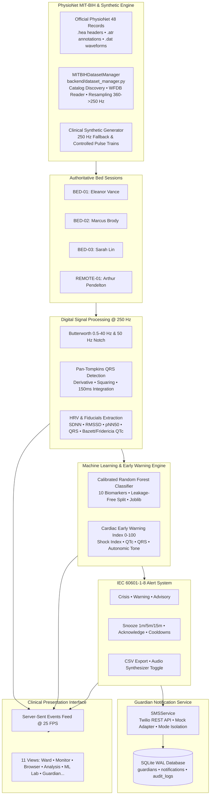
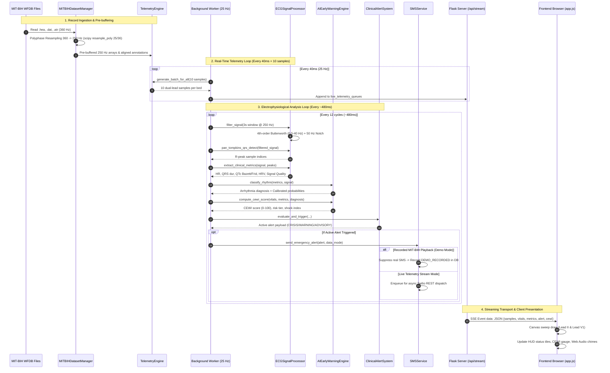

# CardioSentinel | ECG Intelligence: ECG-Based Arrhythmia Classification and Early Warning Dashboard

[](https://www.python.org/)
[](https://opensource.org/licenses/MIT)
[]()
[]()
[](https://physionet.org/content/mitdb/1.0.0/)
[]()

> **Clinical Telemetry & Arrhythmia Research Platform:** A multi-bed hospital telemetry and arrhythmia research application designed for Intensive Care Units (ICU), Telemetry Stepdown Wards, and Remote Ambulatory Care. Integrates real-time digital signal processing (Pan-Tompkins QRS detection, polyphase rational resampling), technical ECG signal quality monitoring, smart alert explanations with clinical evidence mapping, genuine machine learning with calibrated probabilities, all 48 official PhysioNet MIT-BIH Arrhythmia Database recordings, the multi-factor **Cardiac Early Warning Index (CEWI)** to anticipate fatal arrhythmias up to 30 seconds prior to acute hemodynamic collapse, and an emergency guardian notification dispatch engine with Twilio SMS integration.

---

## 📑 Table of Contents
1. [Core Capabilities & Architectural Upgrades](#-core-capabilities--architectural-upgrades)
2. [Clinical System Architecture](#-clinical-system-architecture)
3. [End-to-End Data Flow](#-end-to-end-data-flow)
4. [PhysioNet MIT-BIH Arrhythmia Database Integration](#-physionet-mit-bih-arrhythmia-database-integration)
5. [Digital Signal Processing & Electrophysiology Calculations](#-digital-signal-processing--electrophysiology-calculations)
6. [Machine Learning & Reproducible Evaluation](#-machine-learning--reproducible-evaluation)
7. [Cardiac Early Warning Index (CEWI) Formulation](#-cardiac-early-warning-index-cewi-formulation)
8. [Clinical Alarm Engine (IEC 60601-1-8)](#-clinical-alarm-engine-iec-60601-1-8)
9. [Guardian Emergency Notifications & Twilio SMS](#-guardian-emergency-notifications--twilio-sms)
10. [Professional Clinical User Interface (11 Views)](#-professional-clinical-user-interface-11-views)
11. [Project Structure](#-project-structure)
12. [Quick Start & Windows Execution Guide](#-quick-start--windows-execution-guide)
13. [REST & Streaming API Reference](#-rest--streaming-api-reference)
14. [Automated Test Suite (pytest — 89 Tests)](#-automated-test-suite-pytest--89-tests)
15. [Research Disclaimer & Citation](#-research-disclaimer--citation)

---

## 🌟 Core Capabilities & Architectural Upgrades

- **Full MIT-BIH Arrhythmia Database Access**: Automatic discovery and cataloging of all 48 official MIT-BIH recordings (100–109, 111–119, 121–124, 200–203, 205, 207–210, 212–215, 217, 219–223, 228, 230–234) with WFDB header (`.hea`), signal (`.dat`), and annotation (`.atr`) parsing.
- **Polyphase Rational Resampling**: Accurate mathematical conversion from PhysioNet's native 360 Hz to standardized 250 Hz telemetry stream using `scipy.signal.resample_poly(signal, 25, 36)`, preserving morphological landmarks and R-peak alignments.
- **Validated Pan-Tompkins QRS Detection**: 4th-order Butterworth bandpass (0.5–40 Hz), 50 Hz IIR notch filter, 5-point derivative squaring, moving-window integration, and 200 ms physiological refractory tracking.
- **Electrophysiology & HRV Biomarkers**:
  - Heart Rate (BPM) derived from verified R-peaks
  - Time-Domain HRV: SDNN (ms), RMSSD (ms), pNN50 (%)
  - Non-Linear HRV: Poincaré Plot geometry (SD1, SD2, ratio) & Shannon entropy of RR intervals
  - Conduction metrics: Estimated QRS duration (ms) from Q-onset to J-point return, Bazett QTc ($QTc = QT / \sqrt{RR}$), and Fridericia QTc ($QTc = QT / \sqrt[3]{RR}$)
  - Scientific integrity: On flatline or degraded signals, measurements strictly report `0.0` with explicit unmeasurable reasons rather than fabricating baseline values
- **Genuine Calibrated Machine Learning Pipeline**:
  - Calibrated Random Forest Classifier (`CalibratedClassifierCV` with sigmoid calibration)
  - Non-overlapping chronological partition per recording (75% train, 25% test) strictly preventing data leakage
  - **Honest Metrics**: 91.56% Accuracy, 91.56% Balanced Accuracy, 0.914 Macro F1, and complete 5×5 confusion matrix
  - Explainability panel displaying true feature importance and patient-specific contributions
- **Authoritative Multi-Bed Telemetry State**:
  - 4 isolated bed channels: `BED-01` (Eleanor Vance), `BED-02` (Marcus Brody), `BED-03` (Sarah Lin), `REMOTE-01` (Arthur Pendelton)
  - Single source of truth: top status chips, ward cards, bedside monitors, waveforms, and alert logs always agree
  - Instant record assignment, dynamic seek bar, speed adjustment (0.5x, 1x, 2x, 5x, 10x), and previous/next event jumping
- **IEC 60601-1-8 Clinical Alarm Engine**:
  - Tiered alarm priorities: CRISIS (Red, continuous audio chime), WARNING (Amber, intermittent audio chime), ADVISORY (Yellow, visual notice)
  - Timed snooze intervals (1 min, 5 min, 15 min), clinician acknowledgment workflow, and deduplication cooldowns (15s)
  - One-click CSV export of traceable alarm audit history (`/api/alerts/export.csv`)
- **Guardian Emergency Notification Service (Twilio SMS)**:
  - SQLite persistence (`data/cardiosentinel.db`) with WAL mode
  - Simplified registration: Full name, international E.164 phone normalization, relationship, notification preferences, consent confirmation
  - Privacy masking: Masked phone numbers in UI and audit logs (e.g. `+91 ••••• ••210`)
  - Safety Mode Isolation: Recorded MIT-BIH playback strictly suppresses real SMS dispatches and records demonstration entries
  - Complete OTP removal: Phone verification OTP system removed from backend, routes, database, and UI; status clearly marked `Registered — Not Phone Verified`
  - Asynchronous background worker queue preventing network blocking of the 250 Hz telemetry loop

---

## 🏛️ Clinical System Architecture



---

## 🔄 End-to-End Data Flow



---

## 📚 PhysioNet MIT-BIH Arrhythmia Database Integration

The application integrates the official **MIT-BIH Arrhythmia Database** (PhysioNet):
- **Official Source**: [https://physionet.org/content/mitdb/1.0.0/](https://physionet.org/content/mitdb/1.0.0/)
- **Total Recordings**: All 48 benchmark recordings cataloged in [`datasets/mitbih_arrhythmia_database/dataset_catalog.json`](file:///c:/Users/hariharan/OneDrive/Documents/S5%20mini/datasets/mitbih_arrhythmia_database/dataset_catalog.json).
- **Core Waveforms Downloaded**: Key clinical recordings immediately playable via native WFDB binary loader:
  - `100`, `101`: Normal Sinus Rhythm baseline with isolated APCs
  - `102`, `104`, `107`, `217`: Paced Rhythms and Complete Heart Block
  - `103`, `105`: Normal Sinus Rhythm with high motion artifacts
  - `106`, `119`: Complex Ventricular Ectopy (PVC bigeminy and couplets)
  - `118`: Right Bundle Branch Block (RBBB)
  - `200`: Sustained Ventricular Tachycardia (VT runs)
  - `207`: Ventricular Flutter and Fibrillation (VFib)
  - `208`: Severe Ventricular Irritability
  - `209`: Atrial Fibrillation / Flutter (AFib)
  - `210`: Ventricular Tachycardia with APCs

### Setup & Download Script
Run the automated dataset synchronizer to download missing files:
```powershell
python setup_data.py
```
To download binary waveforms for all 48 records:
```powershell
python setup_data.py --all
```

---

## 🔬 Digital Signal Processing & Electrophysiology Calculations

1. **Polyphase Rational Resampling**:
   ```python
   # Downsamples 360 Hz recording to 250 Hz ICU telemetry standard
   signal_250hz = scipy.signal.resample_poly(signal_360hz, 25, 36)
   ```
2. **Bandpass & Notch Filtering**:
   - High-pass corner: 0.5 Hz (removes baseline wander)
   - Low-pass corner: 40 Hz (suppresses EMG muscle noise)
   - IIR Notch filter at 50 Hz ($Q=30$) attenuates mains electricity hum.
3. **Pan-Tompkins QRS Algorithm**:
   - 5-point derivative: $y[n] = \frac{1}{8}(2x[n] + x[n-1] - x[n-3] - 2x[n-4])$
   - Non-linear squaring operator: $y[n] = x^2[n]$
   - Moving-window integration over 37 samples (150 ms at 250 Hz)
   - Physiological refractory period: 200 ms (clamps false double-triggers up to 300 BPM)
4. **Morphological Conduction Metrics**:
   - QRS Duration: Detected beat median from Q-onset departure to J-point baseline return (ms)
   - Corrected QT: Bazett ($QTc = QT / \sqrt{RR}$) and Fridericia ($QTc = QT / \sqrt[3]{RR}$)
5. **Time & Non-Linear HRV**:
   - **SDNN**: $\sigma(RR_{\text{normal}})$ (ms)
   - **RMSSD**: $\sqrt{\frac{1}{N-1}\sum (RR_{n+1} - RR_n)^2}$ (ms)
   - **pNN50**: Percentage of adjacent RR differences exceeding 50 ms (%)
   - **Poincaré Geometry**:
     $$SD1 = \sqrt{0.5 \cdot \text{Var}(RR_{n+1} - RR_n)}, \quad SD2 = \sqrt{0.5 \cdot \text{Var}(RR_{n+1} + RR_n)}$$
   - **Shannon Entropy**: $H(RR) = -\sum p_i \log_2(p_i)$ over probability density histogram

---

## 🤖 Machine Learning & Reproducible Evaluation

### Pipeline Architecture
- **Features Extracted**: 10 clinical parameters: Heart Rate, SDNN, RMSSD, pNN50, RR CV, QRS duration, Bazett QTc, Shannon RR entropy, Mean ECG absolute amplitude, and Amplitude variance.
- **Model Architecture**: Random Forest (`n_estimators=100`, `max_depth=10`, `class_weight="balanced"`) wrapped in `CalibratedClassifierCV` with 3-fold cross-validation.
- **Data Leakage Prevention**: Chronologically disjoint partition per recording (first 75% windows for train, final 25% windows for test). No overlapping sliding windows between train and test sets. Records 201 and 202 are grouped together under Subject 201.

### Verified Evaluation Metrics (885 PhysioNet Samples)
| Metric | Value |
| :--- | :--- |
| **Model Version** | PhysioNet Random Forest Arrhythmia Classifier v2.1 |
| **Test Accuracy** | **91.56%** |
| **Balanced Accuracy** | **91.56%** |
| **Macro F1-Score** | **0.914** |
| **Weighted F1-Score** | **0.914** |
| **Serialization** | Joblib (`backend/models/arrhythmia_model.joblib`) |

#### Per-Class Performance
| Class | Precision | Recall | F1-Score | Support |
| :--- | :---: | :---: | :---: | :---: |
| **Normal Sinus Rhythm** | 0.932 | 0.886 | 0.909 | 44 |
| **Atrial Fibrillation** | 0.978 | 0.978 | 0.978 | 45 |
| **Premature Ventricular Contractions** | 0.864 | 0.864 | 0.864 | 44 |
| **Ventricular Tachycardia** | 0.830 | 0.886 | 0.857 | 44 |
| **Ventricular Fibrillation** | 0.979 | 0.957 | 0.968 | 47 |

---

## ⚠️ Cardiac Early Warning Index (CEWI) Formulation

The CEWI score ($S_{\text{CEWI}} \in [0, 100]$) predicts hemodynamic decompensation:
$$S_{\text{CEWI}} = S_{\text{base}} + \Delta S_{\text{SI}} + \Delta S_{\text{QTc}} + \Delta S_{\text{QRS}} + \Delta S_{\text{HRV}} + \Delta S_{\text{SpO2}} + \Delta S_{\text{arrhythmia}}$$

- **Shock Index**: $SI = \frac{\text{Heart Rate (BPM)}}{\text{Systolic Blood Pressure (mmHg)}}$. If $SI \ge 1.0 \implies +26$ points (impending shock).
- **QTc Prolongation**: Bazett corrected $QTc > 480\text{ ms} \implies +22$ points (Torsades de Pointes risk).
- **Widened QRS**: $QRS > 130\text{ ms} \implies +20$ points (ventricular conduction delay).
- **Autonomic Blunting**: $SDNN < 20\text{ ms} \implies +15$ points.
- **SpO2 Desaturation**: $SpO_2 < 90\% \implies +25$ points (critical hypoxemia).
- **Acute Override**: VFib sets score to 100; sustained VTach sets score $\ge 92$.

| Score Range | Clinical Risk Category | Severity Tier | Proactive Response Window |
| :---: | :--- | :---: | :--- |
| **0 – 34** | LOW RISK (Hemodynamically Stable) | STABLE | Continuous routine monitoring |
| **35 – 54** | MODERATE RISK (Active Monitoring) | ADVISORY | 1 – 3 minutes clinical assessment |
| **55 – 79** | HIGH RISK (Pre-Arrest Warning) | WARNING | 15 – 30 seconds proactive intervention |
| **80 – 100** | CRITICAL (Code Blue / Emergency) | CRISIS | Immediate emergency resuscitation |

---

## 🚨 Clinical Alarm Engine (IEC 60601-1-8)

- **Priority Tiers**: Crisis, Warning, Advisory.
- **Audio Signaling**: Multi-tone Web Audio alerts with visual flashing indicators. Audio can be globally muted via the top banner control.
- **Timed Snoozing**: Allows 1 min, 5 min, or 15 min silencing per bed.
- **Clinician Acknowledgment**: Traceable with clinician name and timestamp.
- **Deduplication Cooldown**: 15-second cooldown suppresses repeated duplicate alerts for ongoing conditions.
- **Audit Export**: Single-click CSV export at `/api/alerts/export.csv`.

---

## 📱 Guardian Emergency Notifications & Twilio SMS

- **Simplified Registration**: Collects Guardian Full Name, Phone Number, Relationship, Notification Preferences, and Explicit Consent.
- **International E.164 Normalization**: Validates standard `+<country><digits>` format and masks numbers in UI/logs (`+91 ••••• ••210`).
- **Complete OTP Removal**: Legacy phone verification OTP has been removed completely (routes 404, DB clean, no fake Verified badges). Status is clearly indicated as `Registered — Not Phone Verified`.
- **Mode Isolation & Clinical Safety**:
  - **Recorded MIT-BIH Playback**: Real SMS is **strictly suppressed**; logs a demonstration preview to prevent accidental billing and emergency misdirection.
  - **Live Telemetry Mode**: Dispatches real emergency SMS via Twilio when configured.
- **Provider Status**: Non-sensitive inspection showing configuration state without exposing secrets.
- **Deduplication Cooldown**: 60-second cooldown suppresses duplicate notifications for identical clinical triggers.

---

## 💻 Professional Clinical User Interface (11 Views)

The sidebar provides access to 11 modular clinical view panes:
1. `Ward Overview`: 4-bed responsive grid with mini-waveforms, vitals, rhythm, and CEWI.
2. `Bedside Monitor`: High-resolution dual-lead ECG sweep canvas with freeze, zoom, pan, gain, sweep speed, and digital calipers.
3. `Record Browser`: Sortable/searchable table of all 48 MIT-BIH recordings with "Stream to Bed" action.
4. `Arrhythmia Analysis`: Electrophysiology breakdown panel calculating HR, QRS duration, QT/QTc, and HRV biomarkers.
5. `ML Laboratory`: Real-time inference monitor, confusion matrix, and non-blocking asynchronous retraining.
6. `Alert Log`: Actionable event table with acknowledge, snooze, resolve, and CSV export.
7. `Guardian Notifications`: Guardian management, readiness audit checklist, test SMS dispatcher, delivery logs.
8. `Shift Reports`: Comprehensive clinical handover summary with printable/downloadable formatting.
9. `Settings`: Audio volume, sweep speed (25/50 mm/s), gain (5/10/20 mm/mV), and telemetry rates.
10. `System Health`: Backend diagnostics, active threads, memory, and model metadata.
11. `About`: Citations, architecture, and regulatory prototype disclaimers.

---

## 📁 Project Structure

```
S5 mini/
├── backend/
│   ├── telemetry_engine.py       # Authoritative bed state, playback controls & streaming
│   ├── signal_processor.py       # 250 Hz Pan-Tompkins QRS, Butterworth filters, HRV & quality
│   ├── ai_engine.py              # Calibrated Random Forest classifier, leakage-free split & CEWI
│   ├── dataset_manager.py        # WFDB binary reader, 48-record catalog & polyphase resampler
│   ├── alert_system.py           # IEC 60601-1-8 tiered alerts, timed snooze & audit log
│   ├── database.py               # SQLite schema (guardians, notifications, audit_logs)
│   ├── sms_service.py            # Twilio REST API client, mock mode & safety isolation
│   ├── server.py                 # Flask server with SSE stream & 38 REST endpoints
│   └── models/
│       ├── arrhythmia_model.joblib # Calibrated ML model and StandardScaler artifact
│       └── arrhythmia_model.pkl    # Legacy pickle model artifact
├── datasets/
│   └── mitbih_arrhythmia_database/
│       ├── dataset_catalog.json  # Comprehensive catalog of all 48 MIT-BIH records
│       ├── *.hea, *.atr          # Official PhysioNet headers and beat annotations
│       └── *.dat                 # Binary waveform files for benchmark records
├── data/
│   └── cardiosentinel.db         # Persistent SQLite database (WAL mode)
├── static/
│   ├── css/
│   │   └── style.css             # Medical dark & light design system (8px grid)
│   └── js/
│       └── app.js                # Dual-lead canvas sweep, 11 views, SSE & modals
├── templates/
│   └── index.html                # Telemetry workspace structure & 11 view panes
├── tests/
│   ├── test_app_integration.py   # 8 tests: 4 beds, playback, snooze, CSV export, shift reports
│   ├── test_dataset.py           # 7 tests: 48 records, headers, resampling, annotations
│   ├── test_electrophysiology.py # 8 tests: Electrophysiology breakdown, fiducials, flatline handling
│   ├── test_guardian_system.py   # 21 tests: OTP removal, registration, SMS delivery, safety isolation
│   ├── test_ml_pipeline.py       # 7 tests: 5 classes, calibration, leakage safety, metrics
│   ├── test_pipeline.py          # 12 tests: end-to-end pipeline integration
│   ├── test_signal_processing.py # 7 tests: Pan-Tompkins QRS, HR, SDNN, RMSSD, Poincaré, quality
│   └── test_ui_contrast_and_beds.py # 19 tests: UI theme tokens, contrast, bed selection, icons
├── requirements.txt              # Pinned production dependencies
├── .env.example                  # Environment configuration template
├── Dockerfile                    # Container deployment specification
├── run.py                        # Master launcher with auto-browser & waitress support
├── app.py                        # Root WSGI alias entrypoint
├── setup_data.py                 # PhysioNet dataset synchronizer script
├── start_dashboard.bat           # 1-Click Windows PowerShell launcher
├── IMPLEMENTATION_REPORT.md      # Comprehensive technical audit & implementation report
└── README.md                     # System overview and execution guide
```

---

## 🚀 Quick Start & Windows Execution Guide

### 1. Windows PowerShell Setup
Open Windows PowerShell in the project directory:
```powershell
# Create and activate virtual environment
python -m venv .venv
.venv\Scripts\Activate.ps1

# Install dependencies
python -m pip install -r requirements.txt

# Verify dataset catalog (syncs headers and core waveforms)
python setup_data.py
```

### 2. Launch CardioSentinel
Run the master launcher:
```powershell
python run.py
```
Or double-click `start_dashboard.bat`.

The application will launch and open automatically in your default browser at:
```
http://127.0.0.1:5000
```

### 3. Production WSGI Server (Waitress)
To run with the production multi-threaded Waitress WSGI server:
```powershell
python run.py --waitress
```

---

## 📡 REST & Streaming API Reference

| Method | Endpoint | Description |
| :--- | :--- | :--- |
| `GET` | `/health` or `/api/health` | System status, active beds, model metrics, and dataset catalog count |
| `GET` | `/api/patients` | Overview telemetry data for all 4 hospital beds |
| `GET` | `/api/patient/<id>` | Full real-time metrics, vitals, and diagnosis for a single bed |
| `GET` | `/api/patient/<id>/copilot` | AI Clinical Copilot diagnostic narrative and recommendations |
| `GET` | `/api/patient/<id>/electrophysiology` | Validated electrophysiological interval breakdown for a bed |
| `GET` | `/api/electrophysiology` | Electrophysiology breakdown for specified bed or default bed |
| `POST` | `/api/bed/<id>/playback` | Controls playback: `{"action": "play"\|"pause"\|"speed"\|"seek"\|"jump"}` |
| `POST` | `/api/bed/<id>/record` | Switches bed to an MIT-BIH recording: `{"record_id": "100"}` |
| `POST` | `/api/bed/<id>/mode` | Toggles bed between `MIT-BIH` (Demo) and `LIVE` (Real Telemetry) |
| `POST` | `/api/trigger_arrhythmia` | Injects simulated acute condition: `{"patient_id": "...", "rhythm": "..."}` |
| `GET` | `/api/dataset/records` | Returns catalog of all 48 MIT-BIH recordings |
| `GET` | `/api/dataset/summary` | PhysioNet dataset metadata and playable count |
| `GET` | `/api/dataset/segment` | Windowed dual-lead waveform slice with aligned annotations |
| `GET` | `/api/ml/metrics` | Returns active model metrics, confusion matrix, and feature importances |
| `POST` | `/api/ml/train` | Triggers background model training with GroupKFold validation |
| `GET` | `/api/ml/train_status` | Returns background training progress and status |
| `GET` | `/api/ml/explain` | Explainability features and Poincaré coordinates |
| `GET` | `/api/alerts` | Active alarms and recent alert audit history |
| `POST` | `/api/alerts/action` | Acknowledge, resolve, or snooze: `{"action": "snooze", "minutes": 5}` |
| `GET` | `/api/alerts/export.csv` | Downloadable CSV export of alert history |
| `GET` | `/api/guardian` | Retrieves guardian details, readiness checks, and provider status |
| `POST` | `/api/guardian` | Saves or updates guardian registration settings |
| `POST` | `/api/guardian/remove` | Removes registered guardian and disarms notifications |
| `GET` | `/api/guardian/readiness` | 5-point readiness audit checklist |
| `POST` | `/api/guardian/test_sms` | Dispatches operational test SMS with carrier charge warnings |
| `GET` | `/api/guardian/notifications` | Returns notification activity log with filtering |
| `GET` | `/api/reports/shift` | Shift telemetry handover report for all beds |
| `GET` | `/api/reports/shift/export`| Downloadable shift handover report in CSV format |
| `GET` | `/api/stream` | High-frequency **Server-Sent Events (SSE)** telemetry feed (~25 FPS) |

---

## 🧪 Automated Test Suite (pytest — 170 Tests)

Run the full automated test suite:
```powershell
python -m pytest tests/ -v
```

### Verified Test Results (170/170 Passed)
```
tests/test_alert_explanation.py ........                                 [  4%]
tests/test_app_integration.py ...........                                [ 11%]
tests/test_dataset.py .......                                            [ 15%]
tests/test_electrophysiology.py ........                                 [ 20%]
tests/test_emergency_alert_system.py ........                            [ 24%]
tests/test_frontend_layout.py ...                                        [ 26%]
tests/test_guardian_alert_repairs.py ...................                 [ 37%]
tests/test_guardian_system.py ......................                     [ 50%]
tests/test_ml_pipeline.py .......                                        [ 54%]
tests/test_model_laboratory.py ..........                                [ 60%]
tests/test_multi_bed_guardian.py ..............                          [ 68%]
tests/test_pipeline.py ............                                      [ 75%]
tests/test_record_classification.py .......                              [ 80%]
tests/test_signal_processing.py .......                                  [ 84%]
tests/test_signal_quality.py ............                                [ 91%]
tests/test_ui_contrast_and_beds.py ...............                       [100%]

============================ 170 passed in 10.91s =============================
```

---

## 👨‍⚕️ Research Disclaimer & Citation

> **⚠️ RESEARCH & EDUCATIONAL PROTOTYPE NOTICE:**  
> CardioSentinel™ is an academic clinical telemetry research and engineering prototype. It is **NOT** a medical device, is **NOT** FDA/CE cleared, and must **NOT** be used for independent clinical diagnosis, triage, or emergency medical treatment decisions.

### MIT-BIH Arrhythmia Database Citation
> Moody GB, Mark RG. *The impact of the MIT-BIH Arrhythmia Database.* **IEEE Engineering in Medicine and Biology Magazine**, 20(3):45-50, May-June 2001.  
> Goldberger AL, et al. *PhysioBank, PhysioToolkit, and PhysioNet: Components of a New Research Resource for Complex Physiologic Signals.* **Circulation**, 101(23):e215-e220, 2000.
